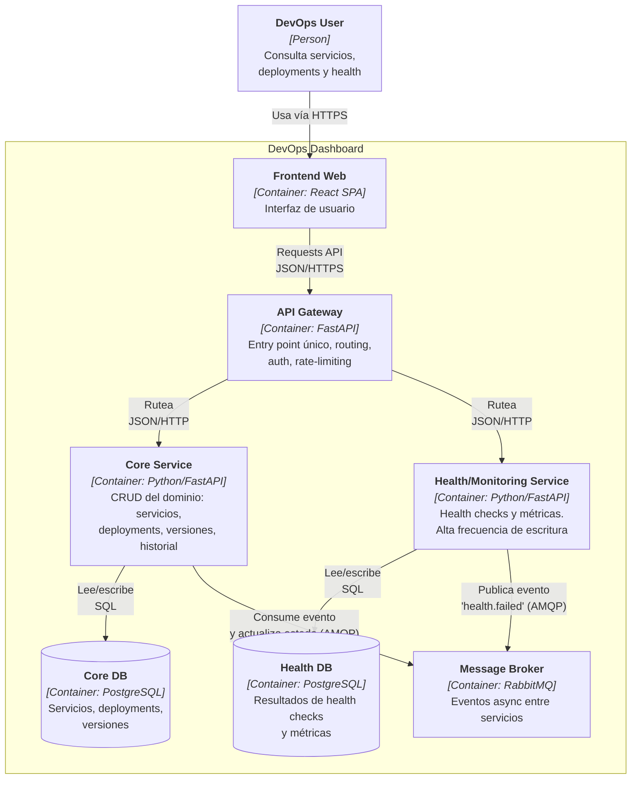

# DevOps Dashboard — Diagrama de Arquitectura (C4 Nivel 2: Container)

Sistema propio de microservicios para gestionar y visualizar servicios, deployments,
estados y health checks. Este diagrama corresponde al **nivel Container** del C4 Model:
muestra las piezas desplegables del sistema, su tecnología y cómo se comunican.

> Nota: los *containers* aquí son unidades desplegables (apps, DBs, broker), no
> contenedores de Docker. El empaquetado con Docker se documenta en fases posteriores.

## Diagrama

## Elementos

| Elemento | Tipo | Tecnología | Responsabilidad |
|----------|------|------------|-----------------|
| DevOps User | Person | — | Consulta el estado del ecosistema de servicios |
| Frontend Web | Container | React (SPA) | Interfaz de usuario; consume la API vía gateway |
| API Gateway | Container | FastAPI | Entry point único; routing, auth, rate-limiting |
| Core Service | Container | Python/FastAPI | CRUD del dominio: servicios, deployments, versiones, historial (`/api/services`, `/api/deployments`) |
| Health/Monitoring Service | Container | Python/FastAPI | Health checks y métricas (`/api/health`); alta frecuencia de escritura, escalado independiente |
| Core DB | Container | PostgreSQL | Persistencia del Core Service |
| Health DB | Container | PostgreSQL | Persistencia del Health/Monitoring Service |
| Message Broker | Container | RabbitMQ | Comunicación asíncrona basada en eventos entre servicios |

## Criterio de división de servicios

Los servicios se dividen **por razón de cambio y patrón de escalado**, no por tipo de
entidad:

- **Core Service** — gestiona el dominio completo (servicios + deployments + versiones,
  que están fuertemente relacionados y se consultan juntos). Cambia cuando cambian las
  reglas del dominio. Patrón de carga: lectura/escritura moderada.
- **Health/Monitoring Service** — gestiona health checks y métricas. Tiene un patrón de
  uso distinto (escritura de alta frecuencia, series temporales) y puede escalar de forma
  independiente. Cambia según las necesidades de observabilidad.

Esta frontera mantiene bajo el acoplamiento entre servicios y da un caso de uso real para
la comunicación asíncrona.

## Decisiones de arquitectura (formalizadas en ADR-001)

- **División por capacidad, no por entidad:** se corta por comportamiento y razón de
  cambio (dominio vs monitoreo), evitando partir un mismo bounded context.
- **Database-per-service:** cada microservicio es dueño de sus datos; no hay base
  compartida. Evita acoplamiento por la capa de datos.
- **Comunicación mixta:** REST síncrono para el flujo usuario → gateway → servicios;
  mensajería asíncrona (AMQP) para el evento `health.failed`, evitando acoplamiento
  temporal entre Core y Health.
- **API Gateway:** un único punto de entrada en lugar de exponer cada servicio
  directamente; centraliza seguridad y simplifica el frontend.
- **Consistencia eventual:** al no haber transacciones ACID entre servicios, se acepta
  consistencia eventual; la reconciliación de datos se maneja vía eventos.

## Fuera del alcance del MVP (documentado, no olvidado)

- **Autenticación real:** el dashboard se asume en red interna; la auth como
  cross-cutting concern se añadirá más adelante.
- **Alta disponibilidad del gateway:** en producción requeriría múltiples instancias tras
  un load balancer (detalle de deployment, no de este diagrama).