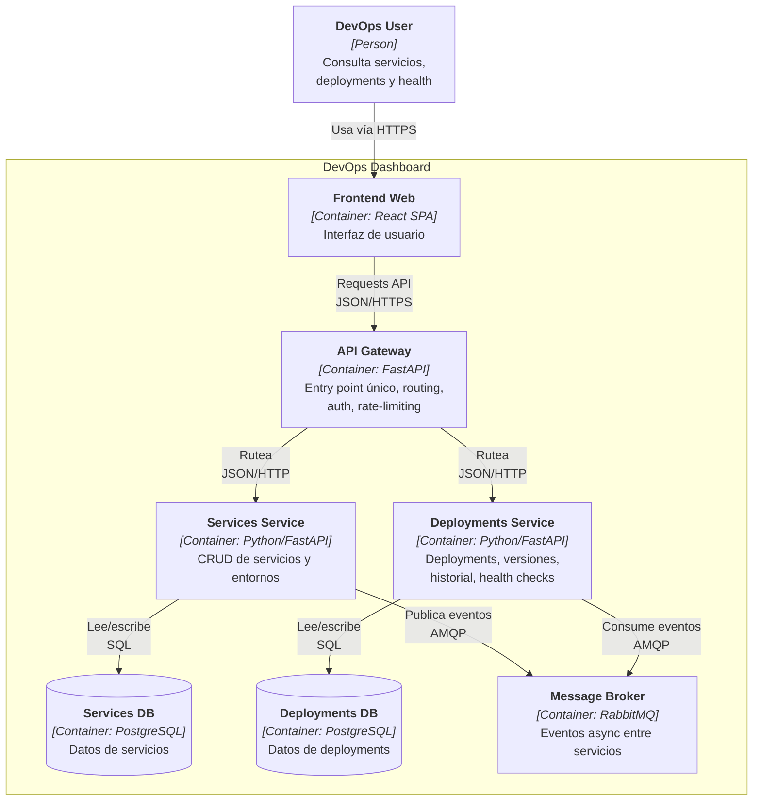

# DevOps Dashboard — Diagrama de Arquitectura (C4 Nivel 2: Container)

Sistema propio de microservicios para gestionar y visualizar servicios, deployments,
estados y health checks. Este diagrama corresponde al **nivel Container** del C4 Model:
muestra las piezas desplegables del sistema, su tecnología y cómo se comunican.

> Nota: los *containers* aquí son unidades desplegables (apps, DBs, broker), no
> contenedores de Docker. El empaquetado con Docker se documenta en fases posteriores.

## Diagrama

## Elementos

| Elemento | Tipo | Tecnología | Responsabilidad |
|----------|------|------------|-----------------|
| DevOps User | Person | — | Consulta el estado del ecosistema de servicios |
| Frontend Web | Container | React (SPA) | Interfaz de usuario; consume la API vía gateway |
| API Gateway | Container | FastAPI | Entry point único; routing, auth, rate-limiting |
| Services Service | Container | Python/FastAPI | Gestión de servicios y entornos (`/api/services`) |
| Deployments Service | Container | Python/FastAPI | Deployments, versiones, historial, health (`/api/deployments`, `/api/health`) |
| Services DB | Container | PostgreSQL | Persistencia del Services Service |
| Deployments DB | Container | PostgreSQL | Persistencia del Deployments Service |
| Message Broker | Container | RabbitMQ | Comunicación asíncrona basada en eventos entre servicios |

## Decisiones de arquitectura (a formalizar en ADR-001)

- **Database-per-service:** cada microservicio es dueño de sus datos; no hay base
  compartida. Evita acoplamiento por la capa de datos.
- **Comunicación mixta:** REST síncrono para el flujo usuario → gateway → servicios;
  mensajería asíncrona (AMQP) para eventos entre servicios, evitando acoplamiento temporal.
- **API Gateway:** un único punto de entrada en lugar de exponer cada servicio
  directamente; centraliza seguridad y simplifica el frontend.